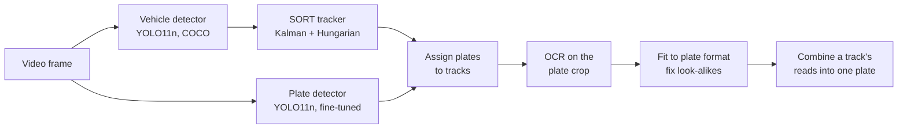
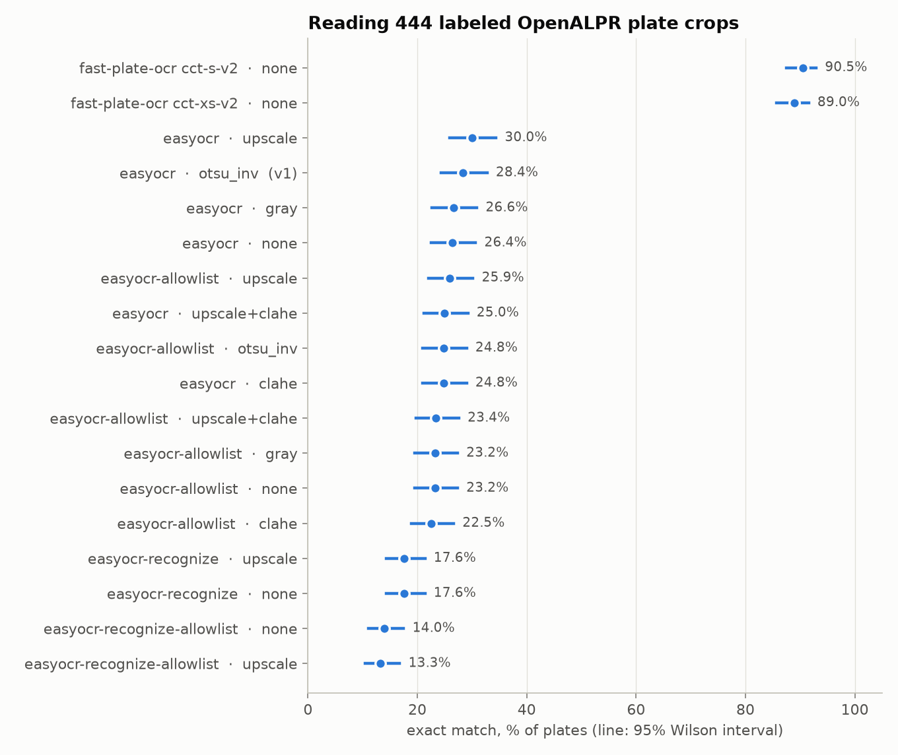
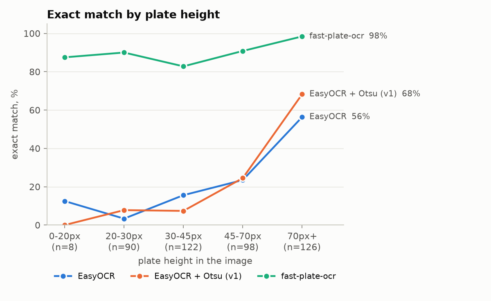
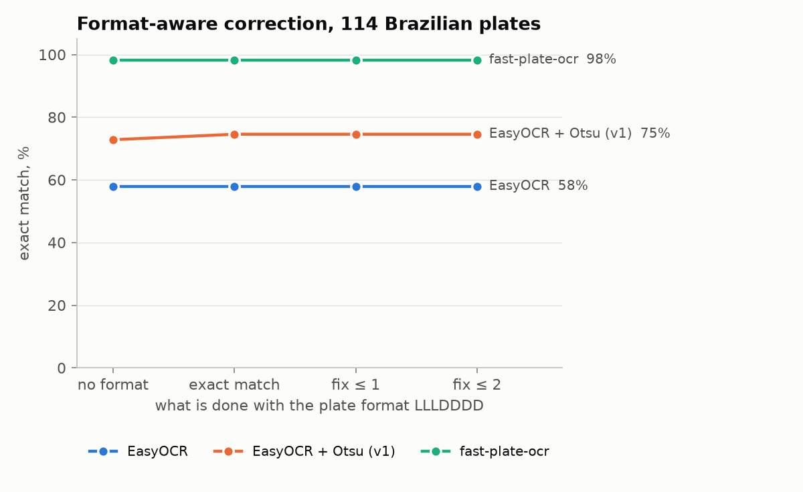
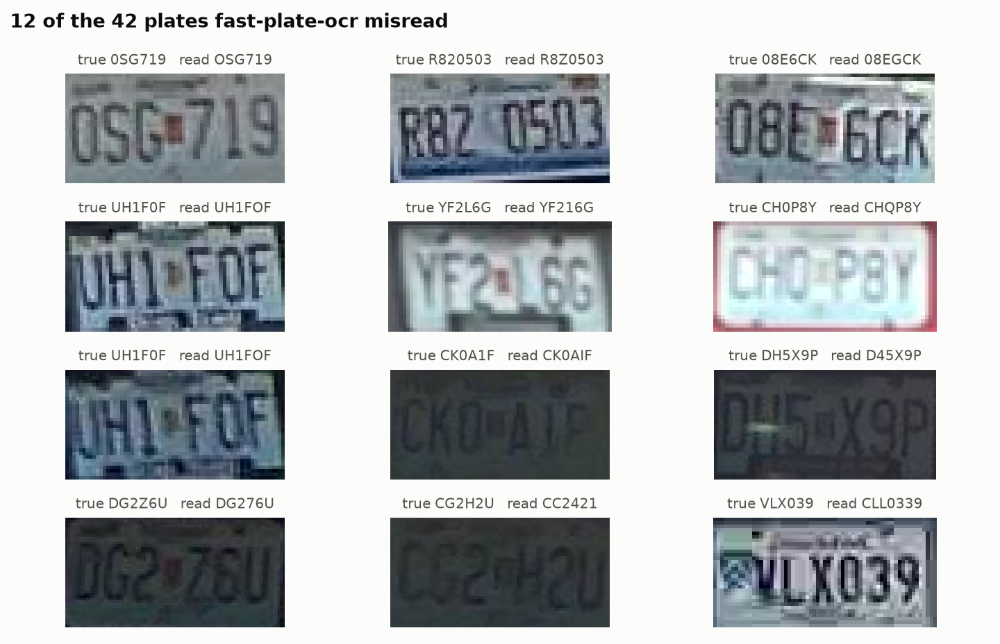

# License Plate Reader

Reads license plates in traffic video: YOLO11 finds vehicles and plates, a SORT
tracker follows each vehicle, an OCR model reads the plate in every frame, and
the reads of a vehicle are combined into one answer. Every number on this page
is produced by a command in the repository and stored in [`results/`](results/).

[](https://github.com/bartkw12/Computer-Vision-Deep-Learning-License-Plate-Reader/actions/workflows/ci.yml)

[](LICENSE)

<!-- results:headline -->
- **Plate reading** on 444 labeled OpenALPR plates: `fast-plate-ocr:cct-s-v2-global-model` reads **90.5% (87-93)** exactly, against 28.4% (24-33) for the first version's EasyOCR + Otsu. 95% Wilson intervals in brackets.
<!-- /results:headline -->

## Contents

- [How it works](#how-it-works)
- [Results](#results)
- [Limitations](#limitations)
- [Quickstart](#quickstart)
- [Reproducing every number](#reproducing-every-number)
- [Project structure](#project-structure)
- [What changed from the first version](#what-changed-from-the-first-version)
- [Roadmap](#roadmap)
- [Acknowledgements](#acknowledgements)

## How it works



| Stage | What it does, and why |
|---|---|
| Vehicle detection | COCO-pretrained YOLO11n, restricted to car, motorcycle, bus and truck, with class-agnostic NMS so a pickup detected as both "car" and "truck" is one vehicle. |
| Tracking | SORT, implemented from the paper in [`src/alpr/tracking/`](src/alpr/tracking/): a constant-velocity Kalman filter per vehicle and Hungarian matching on IoU. A track survives brief missed detections, so one car keeps one ID. |
| Plate detection | YOLO11n fine-tuned on plates. It runs on the full frame by default, or on each tracked vehicle's crop (`plate_search: vehicle`). |
| Association | Each plate goes to the vehicle box that contains most of it, and each vehicle gets at most one plate per frame. Plates on no vehicle are dropped instead of being merged into a fake "car −1". |
| OCR | Pluggable backends: EasyOCR (a general scene-text reader) and fast-plate-ocr (a recognizer trained on plates), with optional crop preprocessing. Reads are gated by plate size and rate-limited per track. |
| Plate format | The text is fitted to a plate format (e.g. Ontario's `LLLLDDD`). Characters of the wrong class are corrected only where the measured evidence supports the correction; otherwise the read is rejected and other frames decide. |
| Aggregation | A track's reads are combined by confidence-weighted vote over whole strings or per character, instead of trusting the single most confident frame. |

The pipeline logs every track in every frame, raw OCR text included, so the format and voting rules can be re-scored from the log without running any model again.

## Results

### Plate reading on public still images

The [OpenALPR benchmark](https://github.com/openalpr/benchmarks) provides car photos from the US, Europe and Brazil with the plate box and text labeled. The first test reads each labeled box directly, so the recognizer is measured on its own (ablations A1 and A2).

<!-- results:ocr-stills -->
444 plates (BR 114, EU 108, US 222), read from their labeled boxes, so the detector plays no part. Exact match compares the whole normalized serial; CER is the character error rate. Latency is on cpu (AMD Ryzen 7 6800HS with Radeon Graphics).

| Reader | Preprocessing | Exact match (95% CI) | CER | BR | EU | US | ms / plate |
| --- | --- | ---: | ---: | ---: | ---: | ---: | ---: |
| `easyocr` | `none` | 26.4% (22-31) | 0.265 | 57.9% | 10.2% | 18.0% | 40 |
| `easyocr` | `gray` | 26.6% (23-31) | 0.265 | 58.8% | 9.3% | 18.5% | 40 |
| `easyocr` | `otsu_inv` (v1) | 28.4% (24-33) | 0.284 | 72.8% | 10.2% | 14.4% | 40 |
| `easyocr` | `clahe` | 24.8% (21-29) | 0.270 | 58.8% | 7.4% | 15.8% | 43 |
| `easyocr` | `upscale` | 30.0% (26-34) | 0.240 | 59.6% | 21.3% | 18.9% | 46 |
| `easyocr` | `upscale+clahe` | 25.0% (21-29) | 0.253 | 59.6% | 11.1% | 14.0% | 51 |
| `easyocr-allowlist` | `none` | 23.2% (20-27) | 0.280 | 61.4% | 8.3% | 10.8% | 42 |
| `easyocr-allowlist` | `gray` | 23.2% (20-27) | 0.280 | 63.2% | 4.6% | 11.7% | 40 |
| `easyocr-allowlist` | `otsu_inv` | 24.8% (21-29) | 0.302 | 70.2% | 5.6% | 10.8% | 42 |
| `easyocr-allowlist` | `clahe` | 22.5% (19-27) | 0.286 | 61.4% | 3.7% | 11.7% | 46 |
| `easyocr-allowlist` | `upscale` | 25.9% (22-30) | 0.251 | 62.3% | 15.7% | 12.2% | 49 |
| `easyocr-allowlist` | `upscale+clahe` | 23.4% (20-28) | 0.268 | 62.3% | 10.2% | 9.9% | 55 |
| `easyocr-recognize` | `none` | 17.6% (14-21) | 0.316 | 45.6% | 3.7% | 9.9% | 10 |
| `easyocr-recognize` | `upscale` | 17.6% (14-21) | 0.310 | 45.6% | 3.7% | 9.9% | 9 |
| `easyocr-recognize-allowlist` | `none` | 14.0% (11-17) | 0.338 | 38.6% | 0.9% | 7.7% | 8 |
| `easyocr-recognize-allowlist` | `upscale` | 13.3% (10-17) | 0.329 | 37.7% | 1.9% | 6.3% | 8 |
| `fast-plate-ocr:cct-xs-v2-global-model` | `none` | 89.0% (86-92) | 0.020 | 93.9% | 92.6% | 84.7% | 2 |
| `fast-plate-ocr:cct-s-v2-global-model` | `none` | **90.5% (87-93)** | 0.018 | 98.2% | 92.6% | 85.6% | 12 |
<!-- /results:ocr-stills -->



The plate-specific recognizer is far ahead of the general scene-text reader. Of the preprocessing steps, the Otsu binarisation used by the first version helps EasyOCR on the high-contrast Brazilian plates and not elsewhere; none of them closes the gap.

**Accuracy by plate size.** The plate height is measured in pixels of the original image.

<!-- results:plate-height -->
| Plate height | Plates | EasyOCR | EasyOCR + Otsu (v1) | fast-plate-ocr |
| --- | ---: | ---: | ---: | ---: |
| 0-20px | 8 | 12.5% | 0.0% | 87.5% |
| 20-30px | 90 | 3.3% | 7.8% | 90.0% |
| 30-45px | 122 | 15.6% | 7.4% | 82.8% |
| 45-70px | 98 | 23.5% | 24.5% | 90.8% |
| 70px+ | 126 | 56.3% | 68.3% | 98.4% |
<!-- /results:plate-height -->



### Format-aware correction (ablation A3, stills)

Every Brazilian plate in the benchmark has the format three letters, four digits, so it is a held-out test of correcting look-alike characters (`O`→`0`, `S`→`5`, ...) by position.

<!-- results:format-br -->
Exact match on the 114 Brazilian plates, which all share the format `LLLDDDD`. In brackets: how many plates got a read at all; a rejected read counts as wrong.

| Format rule | EasyOCR | EasyOCR + Otsu (v1) | fast-plate-ocr |
| --- | ---: | ---: | ---: |
| no format: raw text | 57.9% (114/114) | 72.8% (112/114) | 98.2% (114/114) |
| exact `LLLDDDD` match only | 57.9% (79/114) | 74.6% (97/114) | 98.2% (113/114) |
| look-alike correction, ≤ 1 character | 63.2% (88/114) | 77.2% (101/114) | 98.2% (113/114) |
| look-alike correction, ≤ 2 characters | 64.0% (89/114) | 77.2% (101/114) | 98.2% (113/114) |
<!-- /results:format-br -->



Format knowledge helps the reader that makes look-alike mistakes and leaves nothing to fix for the one that doesn't.

### Which look-alike corrections are real

The correction tables are measured, not assumed: [`scripts/analyze_confusions.py`](scripts/analyze_confusions.py) counts what OCR actually read where the plate format required the other character class, on the US and EU plates only. Some "obvious" corrections did not survive, for example `0`→`D` at a letter position and `Z`→`7` at a digit position, and `8`→`B` was seen too rarely to trust. A test keeps [`plate_format.py`](src/alpr/plate_format.py) equal to this evidence.

<!-- results:lookalikes -->
Evidence: US, EU plates, 2 readers pooled; BR held out. A correction is used when the character was seen at least 5 times in the wrong class and one answer accounts for at least 60.0%.

**A letter where a digit belongs**

| Read | Most often truly | Count | Share | Corrected? |
| --- | --- | ---: | ---: | --- |
| `L` | `4` | 19/30 | 63.3% | yes |
| `O` | `0` | 28/30 | 93.3% | yes |
| `Z` | `7` | 16/27 | 59.3% | no |
| `S` | `5` | 19/25 | 76.0% | yes |
| `G` | `6` | 19/23 | 82.6% | yes |
| `E` | `8` | 10/20 | 50.0% | no |
| `B` | `8` | 12/18 | 66.7% | yes |
| `I` | `1` | 9/11 | 81.8% | yes |
| `A` | `4` | 8/10 | 80.0% | yes |
| `D` | `0` | 5/6 | 83.3% | yes |
| `T` | `1` | 4/6 | 66.7% | yes |

**A digit where a letter belongs** (Ontario passenger series: no G, I, O, Q, U)

| Read | Most often truly | Count | Share | Corrected? |
| --- | --- | ---: | ---: | --- |
| `4` | `A` | 19/23 | 82.6% | yes |
| `0` | `D` | 7/12 | 58.3% | no |
| `1` | `A` | 2/8 | 25.0% | no |
| `I` | `W` | 2/8 | 25.0% | no |
| `U` | `V` | 2/6 | 33.3% | no |
| `5` | `S` | 4/5 | 80.0% | yes |
<!-- /results:lookalikes -->

### Error analysis

<!-- results:confusions -->
Most frequent character substitutions, true → read (count), over all 444 plates.

| # | EasyOCR | EasyOCR + Otsu (v1) | fast-plate-ocr |
| ---: | --- | --- | --- |
| 1 | `0` → `O` (24) | `2` → `Z` (28) | `O` → `0` (8) |
| 2 | `O` → `0` (22) | `4` → `L` (24) | `0` → `O` (6) |
| 3 | `6` → `G` (19) | `0` → `O` (23) | `0` → `Q` (2) |
| 4 | `5` → `S` (19) | `5` → `S` (19) | `1` → `I` (2) |
| 5 | `4` → `L` (19) | `W` → `H` (17) | `H` → `4` (2) |
| 6 | `A` → `4` (19) | `M` → `H` (16) | `8` → `B` (2) |
| 7 | `7` → `Z` (16) | `6` → `G` (13) | `4` → `A` (2) |
| 8 | `W` → `H` (12) | `O` → `0` (13) | `2` → `Z` (1) |
<!-- /results:confusions -->



Some of these misses are disputable labels rather than misreads: the image shows a character the label disagrees with. They are counted as errors all the same.

### Plate detector

The original detector was trained for the first version of this project. Its training settings are recovered from the run's own files rather than retyped:

<!-- results:training-original -->
> _Pending: produced by `python scripts/recover_training_run.py --weights weights/plate_yolo11n_original.pt`._
<!-- /results:training-original -->

Measured with `alpr val` on the dataset's held-out **test** split, next to the validation split used to pick the checkpoint, for the original weights and for a retraining from [`configs/train_plate_detector.yaml`](configs/train_plate_detector.yaml):

<!-- results:detector -->
> _Pending: produced by `alpr val --weights weights/plate_yolo11n_original.pt --split test --out results/detector_original_test.json`._
<!-- /results:detector -->

**Train/test leakage check.** Datasets built from video often put near-identical frames in different splits, which inflates test scores. [`scripts/check_leakage.py`](scripts/check_leakage.py) compares every image with its nearest neighbour in the other splits:

<!-- results:leakage -->
> _Pending: produced by `python scripts/check_leakage.py`._
<!-- /results:leakage -->

### End to end on still images

Detector and reader together on the OpenALPR photos: plate-detection recall at IoU 0.5, then exact match on the detected crops.

<!-- results:endtoend-stills -->
> _Pending: produced by `alpr eval-images --ocr fast-plate-ocr --plate-weights weights/plate_yolo11n.pt --out results/endtoend_stills.json`._
<!-- /results:endtoend-stills -->

### End to end on video

Ontario traffic footage with hand-typed ground truth (`alpr label-sheet`, then `alpr eval-video`): the share of labeled vehicles whose final plate is exactly right, with a 95% interval.

<!-- results:video -->
> _Pending: produced by `alpr run VIDEO, alpr label-sheet, then alpr eval-video --out results/video_eval.json`._
<!-- /results:video -->

### Video ablations

| # | Question | Variants |
|---|---|---|
| A3 | Does format-aware correction help? | off / strict regex (v1) / look-alike-aware |
| A4 | Is one frame enough? | most confident frame (v1) / string vote / per-character vote |
| A5 | Where to look for plates | full frame (v1) / per-vehicle crops |
| A6 | Tracker lifetime | `max_age` 1 (v1) / longer |
| A7 | Cost of OCR | every frame (v1) / gated and rate-limited |

<!-- results:video-ablations -->
> _Pending: produced by `python scripts/run_ablations.py video-replay / video-grid`._
<!-- /results:video-ablations -->

### Runtime

<!-- results:runtime -->
> _Pending: produced by `alpr run VIDEO (its timing.json)`._
<!-- /results:runtime -->

## Limitations

- **Domain.** The still-image results are on US, European and Brazilian plates; the format rules default to Ontario. Accuracy on one does not transfer to the other, which is why the video is evaluated separately.
- **Pretrained recognizer.** fast-plate-ocr's global models were trained on plate data whose overlap with the OpenALPR benchmark is not documented, so their benchmark scores may be optimistic.
- **Sample sizes.** Every accuracy comes with a 95% Wilson interval. Per-region and per-height numbers rest on far fewer plates than the totals, so read small differences in them as noise.
- **Labels.** Benchmark labels are taken as given, including the few that look wrong.
- **Validation numbers.** The detector's validation split chose its checkpoint and is reported only next to the test split, labeled as such.

## Quickstart

Python 3.10 or newer. Linux and macOS commands shown; on Windows use `.venv\Scripts\activate`.

```bash
git clone https://github.com/bartkw12/Computer-Vision-Deep-Learning-License-Plate-Reader.git
cd Computer-Vision-Deep-Learning-License-Plate-Reader
make setup                      # .venv with the package, dev tools and fast-plate-ocr
source .venv/bin/activate
make test-fast                  # tests that need no model weights
```

Put the plate detector at `weights/plate_yolo11n.pt` (see [`weights/README.md`](weights/README.md)); the vehicle detector downloads itself. Then:

```bash
alpr run data/videos/traffic.mp4 --render              # outputs/traffic/: tracks.csv, plates.csv, annotated.mp4
alpr run data/videos/traffic.mp4 --set ocr.backend=fast-plate-ocr --set tracker.max_age=10
```

Every setting is documented in [`configs/pipeline.yaml`](configs/pipeline.yaml); `alpr --help` lists the commands.

## Reproducing every number

| Result | Command | Writes |
|---|---|---|
| Datasets | `python scripts/download_data.py openalpr` · copy the plate dataset to `data/plates/` | `data/` |
| OCR on stills (A1–A3) | `python scripts/run_ablations.py stills` | `results/ablation_ocr_stills.json` |
| Look-alike tables | `python scripts/analyze_confusions.py` | `results/lookalike_evidence.json` |
| Original training run | `python scripts/recover_training_run.py --weights weights/plate_yolo11n_original.pt` | `results/detector_training_original.json` |
| Detector, test split | `alpr val --weights weights/plate_yolo11n_original.pt --split test --out results/detector_original_test.json` | `results/detector_original_test.json` |
| Retraining | `alpr train` | `weights/plate_yolo11n.pt` |
| Leakage check | `python scripts/check_leakage.py` | `results/dataset_leakage.json` |
| End to end, stills | `alpr eval-images --ocr fast-plate-ocr --plate-weights weights/plate_yolo11n.pt --out results/endtoend_stills.json` | `results/endtoend_stills.json` |
| End to end, video | `alpr run VIDEO` → `alpr label-sheet` → `alpr eval-video` | `results/video_eval.json` |
| Video ablations (A3–A7) | `python scripts/run_ablations.py video-replay` / `video-grid` | `results/ablation_video_*.json` |
| Figures and tables | `make figures readme` | `assets/`, this README |

Each results file records the git commit, package versions and hardware it was produced with. `make readme-check` (also run in CI) fails if this README disagrees with `results/`.

## Project structure

```
├── configs/            pipeline.yaml (every setting, documented), train_plate_detector.yaml
├── src/alpr/
│   ├── detection.py    Ultralytics wrapper for both detectors
│   ├── tracking/       SORT: kalman.py, sort.py
│   ├── association.py  plate → vehicle matching
│   ├── ocr/            EasyOCR and fast-plate-ocr backends, preprocessing, cache
│   ├── plate_format.py formats and measured look-alike correction
│   ├── aggregation.py  combining a track's reads
│   ├── pipeline.py     the per-frame loop and its log
│   ├── evaluation/     metrics, still images, video, ablations, leakage
│   └── cli.py          alpr run | render | train | val | eval-images | label-sheet | eval-video
├── scripts/            data download, ablations, confusion analysis, figures, README tables
├── tests/              unit tests per module, plus a synthetic-video test of the whole pipeline
├── results/            the JSON behind every number here
└── assets/             figures
```

## What changed from the first version

The first version (a course project) did not run as committed, and its README reported metrics that could not be reproduced from the repository. The main problems, and what replaced them:

| First version | Now |
|---|---|
| `main_pipeline.py` had an indentation error, and the `sort/` package it imported was not in the repo. | An installable package with a CLI; SORT reimplemented from the paper and tested. |
| OCR correction was dead code: the text had to match `[A-Z]{4}\d{3}` exactly *before* look-alikes were corrected, so there was never anything left to correct. | Correction first, validation after, with a correction table measured from data. |
| A frame with no vehicles crashed the tracker, and plates outside any vehicle were all merged into one fake car. | Empty frames are handled; unmatched plates are dropped. |
| Plates were matched to the first box that strictly contained them, so one pixel of jitter broke the match. | Best overlap above a threshold. |
| The final plate was the single most confident frame. | Votes across all of a track's reads (compared in A4). |
| Reported detector metrics came from the validation split; there were no end-to-end numbers. | Test-split metrics, end-to-end accuracy on stills and video, all with intervals. |
| The training code was a one-line file. | `alpr train` with the configuration recovered from the original run. |

## Roadmap

- ONNX export of both detectors for faster CPU inference.
- A ByteTrack comparison against SORT.
- Fine-tuning the plate recognizer on Ontario plates.

## Acknowledgements

- The first version started from the tutorial [computervisioneng/automatic-number-plate-recognition-python-yolov8](https://github.com/computervisioneng/automatic-number-plate-recognition-python-yolov8) (AGPL-3.0); much of its code was adapted from it. Almost none of that code remains.
- A. Bewley, Z. Ge, L. Ott, F. Ramos, B. Upcroft, ["Simple Online and Realtime Tracking"](https://arxiv.org/abs/1602.00763), ICIP 2016.
- [Ultralytics YOLO](https://github.com/ultralytics/ultralytics) (AGPL-3.0), [EasyOCR](https://github.com/JaidedAI/EasyOCR) (Apache-2.0), [fast-plate-ocr](https://github.com/ankandrew/fast-plate-ocr) (MIT).
- Plate detection data: [License Plate Recognition](https://universe.roboflow.com/roboflow-universe-projects/license-plate-recognition-rxg4e), Roboflow Universe.
- Benchmark images: [openalpr/benchmarks](https://github.com/openalpr/benchmarks) (AGPL-3.0).

## License

[AGPL-3.0](LICENSE), as required by Ultralytics and the tutorial this project started from.
